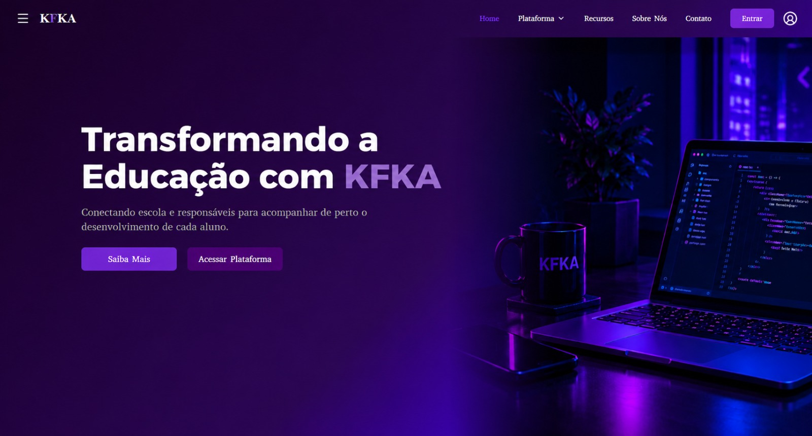

# FECAP - Fundação Escola de Comércio Álvares Penteado

<p align="center">
  <a href="https://www.fecap.br/">
    
  </a>
</p>

# PROJETO KFKA

### Plataforma de Acompanhamento Escolar

**Equipe:** Sintonia Tech  
**Curso:** Análise e Desenvolvimento de Sistemas — FECAP  
**Ano:** 2026

**Aplicação:** https://kfka.alwaysdata.net  
**Repositório:** https://github.com/2026-2-NADS2/Projeto19

## Integrantes

- [Eric Carvalho](https://www.linkedin.com/in/eric-carvalho-9319a4312/)
- [Gabriel Vaz Ferreira Neves](https://www.linkedin.com/in/gabriel-vaz-1593a740a/)
- [Douglas Silva Gadelha Macario](https://www.linkedin.com/in/douglas-macario-2192a5247/)
- [Gustavo Cocoloti Melo](https://www.linkedin.com/in/gustavo-cocoloti-melo-445713328/)

## Professores Orientadores

- [Adriano Felix Valente](https://www.linkedin.com/in/adriano-valente-534576135/)
- [Eduardo Savino Gomes](https://www.linkedin.com/in/eduardo-savino-gomes-77833a10/)
- [Francisco de Souza Escobar](https://www.linkedin.com/in/francisco-escobar/)
- [José Carlos Buesso Jr](https://www.linkedin.com/in/jbuesso/)
- [Ronaldo Araujo Pinto](https://www.linkedin.com/in/ronaldo-araujo-pinto-3542811a/)

---

## 📖 Descrição do Projeto

<p align="center">
  
</p>

O **KFKA** é uma plataforma web de acompanhamento escolar desenvolvida como projeto interdisciplinar do curso de Análise e Desenvolvimento de Sistemas da FECAP, pela equipe Sintonia Tech.

A proposta surgiu da necessidade de organizar e facilitar o acompanhamento do desempenho acadêmico dos estudantes, centralizando informações que podem ser compartilhadas entre professores, administradores escolares e responsáveis.

O projeto acadêmico tem como foco o **Ensino Fundamental**, conforme a proposta original. A estrutura da aplicação também permite cadastrar turmas de outras etapas escolares, dependendo da configuração utilizada.

Por meio do KFKA, professores podem registrar acompanhamentos contendo notas, descrições qualitativas e tags relacionadas ao desenvolvimento dos estudantes. Esses registros passam por um fluxo de revisão administrativa antes de serem disponibilizados aos responsáveis.

A plataforma busca proporcionar uma comunicação mais organizada entre escola e família, facilitando a consulta ao histórico de desempenho e o acompanhamento da evolução acadêmica dos alunos.

---

## 🎯 Objetivos

O objetivo principal do KFKA é desenvolver uma aplicação web capaz de centralizar informações escolares e organizar o processo de registro, revisão e consulta de acompanhamentos acadêmicos.

Entre os objetivos específicos estão:

- Facilitar o registro do desempenho dos estudantes pelos professores.
- Centralizar informações de alunos, turmas, disciplinas e períodos avaliativos.
- Permitir que a administração revise e publique acompanhamentos.
- Disponibilizar informações acadêmicas aos responsáveis autorizados.
- Organizar os vínculos entre professores, turmas, disciplinas, alunos e responsáveis.
- Aplicar conhecimentos de desenvolvimento Full Stack, banco de dados, estruturas de dados e programação orientada a objetos.
- Desenvolver uma interface organizada e acessível aos diferentes perfis de usuário.

---

## 👥 Perfis de Usuário

O KFKA possui três perfis principais, com funcionalidades e permissões específicas.

### 👨‍💼 Administrador

O administrador é responsável pelo gerenciamento das informações escolares e pela revisão dos acompanhamentos enviados pelos professores.

Principais funcionalidades:

- Cadastro e gerenciamento de usuários.
- Cadastro e gerenciamento de alunos.
- Cadastro de turmas e disciplinas.
- Configuração de períodos avaliativos.
- Organização dos vínculos entre professores, turmas e disciplinas.
- Associação de responsáveis aos alunos.
- Consulta dos acompanhamentos cadastrados.
- Revisão dos registros enviados pelos professores.
- Aprovação, devolução para correção e publicação de acompanhamentos.
- Consulta de informações e relatórios administrativos.
- Exportação de informações em formato CSV.

### 👨‍🏫 Professor

O professor utiliza a plataforma para registrar e acompanhar o desempenho acadêmico dos estudantes vinculados às suas turmas e disciplinas.

Principais funcionalidades:

- Consulta dos alunos vinculados.
- Pesquisa e filtragem de estudantes por turma.
- Registro de acompanhamentos acadêmicos.
- Inserção de notas, médias e observações.
- Associação de tags aos registros.
- Organização por disciplina e período avaliativo.
- Salvamento de acompanhamentos como rascunho.
- Envio dos registros para revisão administrativa.
- Consulta do status dos acompanhamentos.
- Correção de registros devolvidos pela administração.

### 👨‍👩‍👧 Responsável

O responsável possui acesso às informações acadêmicas dos estudantes vinculados à sua conta.

Principais funcionalidades:

- Consulta dos alunos vinculados ao seu perfil.
- Visualização de acompanhamentos publicados.
- Consulta de notas, médias e observações escolares.
- Acompanhamento da evolução acadêmica.
- Visualização de gráficos de desempenho.
- Geração e download de relatórios em PDF.

O acesso às informações deve respeitar os vínculos cadastrados, impedindo que um responsável consulte dados de alunos não associados à sua conta.

---

## 🔄 Funcionamento da Plataforma

O KFKA organiza o acompanhamento escolar em um fluxo que envolve professores, administradores e responsáveis.

### 1. Cadastro e organização

O administrador realiza os cadastros necessários para o funcionamento do sistema, incluindo usuários, alunos, turmas, disciplinas e períodos avaliativos.

Também são estabelecidos os vínculos entre professores, turmas, disciplinas, responsáveis e estudantes.

### 2. Registro do acompanhamento

O professor seleciona um aluno vinculado às suas turmas e registra as informações acadêmicas.

O acompanhamento pode conter:

- Aluno.
- Professor.
- Turma.
- Disciplina.
- Período avaliativo.
- Nota ou média.
- Descrição do desempenho.
- Tags de acompanhamento.

### 3. Salvamento e envio

Após preencher as informações, o professor pode salvar o acompanhamento como rascunho ou encaminhá-lo para revisão administrativa.

### 4. Revisão administrativa

O administrador analisa o registro e pode aprová-lo ou devolvê-lo ao professor para correção.

### 5. Publicação

Após a revisão e publicação, o acompanhamento passa a ficar disponível para os responsáveis autorizados.

### 6. Consulta dos responsáveis

Os responsáveis acessam os registros publicados dos alunos vinculados às suas contas e podem consultar as informações acadêmicas e gerar relatórios.

### Fluxo resumido

```text
ADMINISTRADOR
     |
     | Cadastra alunos, turmas, disciplinas e vínculos
     |
     v
PROFESSOR
     |
     | Registra o acompanhamento
     | Salva como rascunho
     | Envia para revisão
     |
     v
ADMINISTRADOR
     |
     | Analisa o acompanhamento
     |
     +----> Devolve para correção
     |             |
     |             v
     |         PROFESSOR
     |             |
     |             +----> Reenvia
     |
     +----> Aprova e publica
                   |
                   v
              RESPONSÁVEL
                   |
                   | Consulta os registros
                   | Gera relatórios
                   v
                  FIM
```

---

## 📂 Estrutura de Pastas

O repositório reúne a aplicação Full Stack, os arquivos relacionados ao banco de dados e os materiais desenvolvidos para as disciplinas do projeto interdisciplinar.

```text
Projeto19/
│
├── database/
│   └── kfka.sql
│
├── documentos/
│   ├── Entrega 1/
│   │   ├── Banco de Dados/
│   │   └── Design de Interface Digital/
│   │
│   └── Entrega 2/
│       ├── Banco de Dados/
│       └── Estrutura de Dados/
│
├── imagens/
│
├── src/
│   ├── Estrutura_de_Dados/
│   │
│   ├── FullStack/
│   │   ├── Backend/
│   │   │   ├── sql/
│   │   │   ├── src/
│   │   │   │   ├── bancoDados.js
│   │   │   │   ├── criarAdmin.js
│   │   │   │   ├── middlewares/
│   │   │   │   └── routes/
│   │   │   ├── .env.example
│   │   │   ├── index.js
│   │   │   ├── package.json
│   │   │   └── package-lock.json
│   │   │
│   │   ├── Frontend/
│   │   │   ├── public/
│   │   │   ├── src/
│   │   │   │   ├── assets/
│   │   │   │   ├── componentes/
│   │   │   │   ├── paginas/
│   │   │   │   ├── servicos/
│   │   │   │   ├── App.jsx
│   │   │   │   └── main.jsx
│   │   │   ├── index.html
│   │   │   ├── package.json
│   │   │   └── vite.config.js
│   │   │
│   │   └── package-lock.json
│   │
│   └── POO/
│
├── .gitignore
├── iniciar.bat
├── package-lock.json
└── README.md
```

### Descrição das principais pastas

| Pasta | Descrição |
|---|---|
| `database/` | Arquivos SQL relacionados ao banco de dados. |
| `documentos/` | Documentação acadêmica organizada por entrega e disciplina. |
| `imagens/` | Imagens utilizadas na documentação. |
| `src/Estrutura_de_Dados/` | Implementações relacionadas à disciplina de Estrutura de Dados. |
| `src/FullStack/Backend/` | API, autenticação, regras de negócio e comunicação com o MySQL. |
| `src/FullStack/Frontend/` | Interface web desenvolvida com React. |
| `src/POO/` | Atividades e projetos de Programação Orientada a Objetos. |

---

## 🛠️ Tecnologias Utilizadas

<p align="center">
  
</p>

O projeto utiliza tecnologias de desenvolvimento web Full Stack, banco de dados relacional e ferramentas de versionamento.

### Frontend

| Tecnologia | Utilização |
|---|---|
| HTML5 | Estruturação das páginas. |
| CSS3 | Estilização e responsividade. |
| JavaScript | Lógica e interatividade. |
| React | Desenvolvimento da interface por componentes. |
| Vite | Ambiente de desenvolvimento e compilação. |
| React Router | Navegação e gerenciamento de rotas. |
| Lucide React | Ícones utilizados na interface. |
| jsPDF | Geração de documentos PDF. |

### Backend

| Tecnologia | Utilização |
|---|---|
| Node.js | Execução do JavaScript no servidor. |
| Express.js | Desenvolvimento da API e gerenciamento das rotas. |
| JWT | Autenticação baseada em tokens assinados. |
| bcryptjs | Geração e verificação de hashes de senhas. |
| CORS | Configuração da comunicação entre origens. |
| dotenv | Leitura das variáveis de ambiente. |

### Banco de Dados

| Tecnologia | Utilização |
|---|---|
| MySQL | Armazenamento relacional dos dados. |
| MySQL2 | Comunicação entre o backend e o banco. |
| MySQL Workbench | Administração e execução de comandos SQL. |

### Ferramentas e Hospedagem

| Ferramenta | Utilização |
|---|---|
| Visual Studio Code | Desenvolvimento e edição do código. |
| Git | Controle de versões. |
| GitHub | Hospedagem do repositório e colaboração. |
| GitHub Desktop | Gerenciamento visual dos commits. |
| Alwaysdata | Hospedagem da aplicação web. |

---

## 🗄️ Banco de Dados

O KFKA utiliza o **MySQL** para armazenar as informações da plataforma.

A estrutura relacional permite organizar os dados em diferentes tabelas, utilizando chaves primárias e estrangeiras para estabelecer vínculos entre os registros.

### Principais tabelas

| Tabela | Finalidade |
|---|---|
| `usuarios` | Armazena administradores, professores e responsáveis. |
| `alunos` | Armazena os dados cadastrais dos estudantes. |
| `turmas` | Organiza as turmas escolares. |
| `disciplinas` | Armazena as disciplinas cadastradas. |
| `alunos_turmas` | Relaciona alunos às turmas. |
| `professores_turmas_disciplinas` | Relaciona professores, turmas e disciplinas. |
| `responsaveis_alunos` | Relaciona responsáveis aos estudantes. |
| `periodos_avaliativos` | Organiza os períodos de avaliação. |
| `acompanhamentos` | Armazena os registros de desempenho acadêmico. |
| `tags` | Armazena classificações dos acompanhamentos. |
| `acompanhamentos_tags` | Relaciona tags aos acompanhamentos. |
| `comentarios` | Armazena comentários associados aos registros. |
| `revisoes_acompanhamentos` | Registra informações relacionadas às revisões. |

A estrutura pode receber tabelas adicionais conforme a evolução da aplicação e a aplicação de migrações.

### Arquivos SQL

O repositório contém o arquivo principal:

```text
database/kfka.sql
```

Também existem scripts complementares em:

```text
src/FullStack/Backend/sql/
```

Esses arquivos podem incluir ajustes estruturais e migrações utilizadas durante o desenvolvimento.

**Atenção:** antes de executar scripts SQL, confira o banco selecionado e faça um backup. O arquivo `database/kfka.sql` pode conter comandos como `DROP TABLE`, capazes de excluir tabelas e dados existentes.

O banco de dados instalado localmente não é sincronizado automaticamente com o arquivo SQL do GitHub nem com o banco utilizado na hospedagem.

---

## 💻 Como Executar o Projeto

Para executar o KFKA localmente, é necessário configurar o MySQL, o backend e o frontend.

### Pré-requisitos

- Node.js e npm.
- MySQL Server.
- MySQL Workbench ou outro cliente MySQL.
- Git.
- Editor de código, como Visual Studio Code.

### 1. Clonar o repositório

Abra um terminal e execute:

```bash
git clone https://github.com/2026-2-NADS2/Projeto19.git
```

Acesse a pasta do projeto:

```bash
cd Projeto19
```

### 2. Configurar o banco de dados

Abra o MySQL Workbench e conecte-se ao servidor MySQL.

Para importar o arquivo SQL:

1. Acesse `Server > Data Import`.
2. Selecione `Import from Self-Contained File`.
3. Escolha o arquivo SQL do projeto.
4. Configure o schema de destino.
5. Execute `Start Import`.

O banco utilizado pela aplicação se chama:

```text
kfka
```

Verifique se o arquivo SQL corresponde à versão atual da aplicação.

**Importante:** faça a importação inicial em um banco vazio ou de testes. Não execute scripts com comandos destrutivos sobre um banco que contenha dados importantes.

### 3. Configurar o backend

Na raiz do repositório, acesse:

```bash
cd src/FullStack/Backend
```

Instale as dependências:

```bash
npm install
```

Crie um arquivo `.env` dentro da pasta `Backend`, utilizando o `.env.example` como referência.

Exemplo:

```env
DB_HOST=localhost
DB_PORT=3306
DB_USER=root
DB_PASSWORD=SUA_SENHA_MYSQL
DB_NAME=kfka

JWT_SECRET=DEFINA_UMA_CHAVE_SECRETA_FORTE
PORT=3333
```

Substitua os valores pelas configurações do seu ambiente.

O `JWT_SECRET` deve ser uma chave forte e mantida em sigilo.

**Nunca envie arquivos `.env` com senhas ou chaves reais para o GitHub.**

### 4. Criar o administrador inicial

Caso o banco ainda não possua um administrador, acrescente as seguintes variáveis ao `.env` do backend:

```env
ADMIN_NOME=Administrador KFKA
ADMIN_EMAIL=admin@kfka.com
ADMIN_SENHA=ESCOLHA_UMA_SENHA_FORTE
```

O e-mail apresentado é apenas um exemplo para configuração local.

Utilize uma senha de pelo menos 12 caracteres.

Dentro da pasta `Backend`, execute:

```bash
node src/criarAdmin.js
```

O script cria o usuário administrador e armazena sua senha utilizando hash.

Se o e-mail já estiver cadastrado, o script informa a existência do usuário.

### 5. Iniciar o backend

Ainda na pasta `Backend`, execute:

```bash
npm run dev
```

O servidor será iniciado, por padrão, em:

```text
http://localhost:3333
```

Para verificar a API, acesse:

```text
http://localhost:3333/
```

Em ambiente de desenvolvimento, a rota abaixo pode ser utilizada para verificar a conexão com o MySQL, caso esteja habilitada:

```text
http://localhost:3333/teste-banco
```

### 6. Configurar o frontend

Abra outro terminal e, a partir da raiz do repositório, acesse:

```bash
cd src/FullStack/Frontend
```

Instale as dependências:

```bash
npm install
```

Caso seja necessário configurar o endereço da API, crie um arquivo `.env` na pasta `Frontend`:

```env
VITE_API_URL=http://localhost:3333
```

### 7. Iniciar o frontend

Execute:

```bash
npm run dev
```

O Vite exibirá o endereço da aplicação, geralmente:

```text
http://localhost:5173/
```

Abra o endereço no navegador para acessar o KFKA.

### 8. Encerrar a aplicação

Para interromper os servidores, pressione:

```text
Ctrl + C
```

Execute esse comando nos terminais do backend e do frontend.

---

## 🚀 Inicialização Automática no Windows

O repositório possui um arquivo de inicialização:

```text
Projeto19/iniciar.bat
```

O objetivo desse arquivo é facilitar a execução local da aplicação no Windows.

Ele foi preparado para:

1. Verificar a disponibilidade do Node.js e npm.
2. Verificar as pastas do frontend e backend.
3. Conferir a existência do `.env` do backend.
4. Instalar as dependências dos projetos com `npm ci`.
5. Abrir os servidores em terminais separados.
6. Aguardar o frontend e abrir a aplicação no navegador.

Para utilizá-lo, é necessário configurar previamente o MySQL, importar o banco e preparar o arquivo `.env`.

**O inicializador não instala o MySQL, não importa o banco de dados e não cria automaticamente o administrador.**

A versão mais recente do `iniciar.bat` ainda precisa de uma validação completa em um ambiente configurado.

---

## 🔐 Autenticação e Segurança

O KFKA utiliza autenticação baseada em **JWT (JSON Web Token)** e controle de permissões conforme o perfil do usuário.

### Processo de autenticação

1. O usuário informa e-mail e senha.
2. O backend recebe e valida as credenciais.
3. A senha informada é comparada com o hash armazenado.
4. Após a autenticação, o backend gera um token JWT.
5. O frontend envia o token nas requisições autenticadas.
6. O backend verifica a validade do token e as permissões necessárias.

### Proteção das senhas

As senhas são armazenadas utilizando hashes gerados com `bcryptjs`, evitando seu armazenamento em texto simples.

### Controle de acesso

As funcionalidades são separadas de acordo com os três perfis:

- **Administrador:** gerenciamento escolar e revisão dos acompanhamentos.
- **Professor:** registro e acompanhamento dos estudantes autorizados.
- **Responsável:** consulta das informações publicadas dos alunos vinculados.

A autorização deve ser verificada no backend, não apenas pela interface.

### Termos de Uso e Política de Privacidade

O projeto também possui um fluxo experimental para registrar a ciência dos Termos de Uso e da Política de Privacidade.

A funcionalidade utiliza a variável:

```env
KFKA_CIENCIA_LEGAL_TESTE=true
```

Esse recurso é destinado a ambientes de teste e utiliza minutas ainda sujeitas a revisão.

O script SQL relacionado está localizado em:

```text
src/FullStack/Backend/sql/ciencias_documentos_legais.sql
```

A funcionalidade deve permanecer desabilitada em produção até que os documentos, o banco de dados e o comportamento da aplicação sejam devidamente validados.

A ciência desses documentos é diferente da confirmação de leitura de um acompanhamento escolar publicado.

---

## 📊 Relatórios e Acompanhamento Acadêmico

O KFKA possui recursos voltados à consulta e apresentação das informações escolares.

### Relatórios em PDF

A plataforma possui funcionalidade de geração de documentos PDF com informações dos acompanhamentos acadêmicos.

A implementação utiliza a biblioteca `jsPDF`.

### Exportação em CSV

O módulo administrativo possui recursos de exportação de informações em formato CSV.

Os arquivos podem ser abertos em programas de planilhas, como Microsoft Excel e LibreOffice Calc.

### Gráficos de desempenho

A interface possui recursos de visualização gráfica voltados ao acompanhamento da evolução acadêmica dos estudantes.

Esses recursos auxiliam na interpretação das notas e dos registros realizados durante os períodos avaliativos.

**Observação:** a presença dessas funcionalidades no projeto não substitui a necessidade de validar o fluxo completo com dados reais de teste e os diferentes perfis de usuário.

---

## 🧪 Testes e Validação

Durante o desenvolvimento, foram realizados testes e verificações de diferentes funcionalidades da aplicação.

Entre os cenários trabalhados estão:

- Inicialização do backend.
- Comunicação com o banco MySQL.
- Autenticação de usuários.
- Controle de acesso por perfil.
- Cadastro de usuários, alunos e turmas.
- Vínculos entre alunos, responsáveis, professores e disciplinas.
- Registro de acompanhamentos.
- Salvamento de rascunhos.
- Envio para revisão administrativa.
- Publicação e consulta dos acompanhamentos.
- Geração de documentos PDF.
- Exportação de dados em CSV.
- Compilação do frontend com Vite.

Também foram realizadas verificações de acesso à API, conexão com o MySQL, criação de administrador e login no ambiente local.

Alguns fluxos ainda dependem de uma validação integrada completa, especialmente a sequência entre professor, administrador e responsável na versão mais recente do sistema.

### Fluxo principal para validação

```text
Administrador cadastra os dados escolares
                  |
                  v
Professor registra um acompanhamento
                  |
                  v
Professor envia para revisão
                  |
                  v
Administrador revisa e publica
                  |
                  v
Responsável consulta o acompanhamento
                  |
                  v
Responsável gera o relatório PDF
```

Esse fluxo representa o cenário principal de funcionamento previsto para o projeto.

---

## 🌐 Hospedagem

A aplicação utiliza a plataforma **Alwaysdata** para hospedagem.

Endereço do projeto:

https://kfka.alwaysdata.net

O código-fonte e o histórico de desenvolvimento estão disponíveis no GitHub:

https://github.com/2026-2-NADS2/Projeto19

O ambiente de hospedagem possui configurações próprias de aplicação e banco de dados. Alterações enviadas ao GitHub não significam necessariamente uma atualização automática do site publicado.

---

## 🤖 Utilização de Inteligência Artificial

Durante o desenvolvimento do KFKA, ferramentas de inteligência artificial foram utilizadas como apoio em atividades de programação, interpretação de erros, organização de código, planejamento e documentação.

As sugestões geradas foram utilizadas como material de apoio ao desenvolvimento, com necessidade de revisão, adaptação e testes.

A documentação acadêmica sobre a utilização de inteligência artificial é apresentada na **Ficha de Declaração de Uso de IA**, preparada como material complementar do projeto.

---

## 📚 Referências

As seguintes documentações e materiais foram utilizados como referência:

1. [React](https://react.dev/) — Documentação oficial.
2. [MDN Web Docs](https://developer.mozilla.org/pt-BR/) — HTML, CSS e JavaScript.
3. [Vite](https://vite.dev/) — Documentação oficial.
4. [Node.js](https://nodejs.org/) — Documentação oficial.
5. [Express](https://expressjs.com/) — Documentação oficial.
6. [MySQL](https://dev.mysql.com/doc/) — Documentação oficial.
7. [React Router](https://reactrouter.com/) — Documentação oficial.
8. [JWT](https://jwt.io/) — Referência sobre JSON Web Tokens.
9. [Git](https://git-scm.com/doc) — Documentação oficial.
10. [GitHub Docs](https://docs.github.com/pt) — Documentação oficial.
11. [Toptal Gitignore](https://www.toptal.com/developers/gitignore) — Gerador de arquivos `.gitignore`.
12. [README Template - Iuri Silva](https://github.com/iuricode/readme-template) — Referência de documentação.
13. [README Model - Gabriel de Jesus](https://github.com/gabrieldejesus/readme-model) — Modelo de README.

---

## 📌 Informações Acadêmicas

**Instituição:** Fundação Escola de Comércio Álvares Penteado — FECAP

**Curso:** Análise e Desenvolvimento de Sistemas

**Projeto:** KFKA — Plataforma de Acompanhamento Escolar

**Equipe:** Sintonia Tech

**Ano:** 2026

---

<p align="center">
  Desenvolvido pela equipe <strong>Sintonia Tech</strong> como parte do Projeto Interdisciplinar do curso de Análise e Desenvolvimento de Sistemas da FECAP.
</p>
