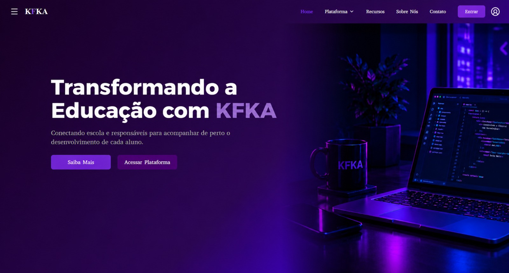

# FECAP - Fundação de Comércio Álvares Penteado

<p align="center">
  <a href="https://www.fecap.br/">
    
  </a>
</p>

# PROJETO KFKA

## Sintonia Tech

## Integrantes

- [Douglas Silva Gadelha Macario](https://www.linkedin.com/in/douglas-macario-2192a5247/)
- [Eric Carvalho](https://www.linkedin.com/in/eric-carvalho-9319a4312/)
- [Gabriel Vaz Ferreira Neves](https://www.linkedin.com/in/gabriel-vaz-1593a740a/)
- [Gustavo Cocoloti Melo](https://www.linkedin.com/in/gustavo-cocoloti-melo-445713328/)

## Professores Orientadores

- [Adriano Felix Valente](https://www.linkedin.com/in/adriano-valente-534576135/)
- [Eduardo Savino Gomes](https://www.linkedin.com/in/eduardo-savino-gomes-77833a10/)
- [Francisco de Souza Escobar](https://www.linkedin.com/in/francisco-escobar/)
- [José Carlos Buesso Jr](https://www.linkedin.com/in/jbuesso/)
- [Ronaldo Araujo Pinto](https://www.linkedin.com/in/ronaldo-araujo-pinto-3542811a/)

---

## 📖 Descrição

<p align="center">
  
</p>

O **KFKA** é uma plataforma digital de acompanhamento escolar desenvolvida para facilitar a comunicação entre professores, gestão escolar e responsáveis por alunos do Ensino Fundamental.

O sistema centraliza o registro e o compartilhamento de informações acadêmicas, permitindo acompanhar o desempenho e a evolução dos estudantes durante os períodos avaliativos.

Os professores podem registrar médias, observações qualitativas e tags relacionadas ao desempenho dos alunos. Antes de serem disponibilizados aos responsáveis, os acompanhamentos passam por um processo de revisão realizado pela administração escolar.

Após a aprovação e publicação, os responsáveis podem consultar os relatórios dos alunos vinculados aos seus perfis, visualizar informações sobre o desenvolvimento escolar e gerar documentos em PDF.

A plataforma também disponibiliza recursos administrativos, como gerenciamento de usuários, alunos, turmas, disciplinas, períodos avaliativos e relatórios.

Dessa forma, o KFKA reúne informações acadêmicas em um ambiente organizado, contribuindo para o acompanhamento pedagógico e para uma comunicação mais eficiente entre escola e família.

---

## 🎯 Objetivo do Projeto

O objetivo do KFKA é desenvolver uma plataforma web capaz de organizar e facilitar o acompanhamento acadêmico dos estudantes, oferecendo funcionalidades específicas para cada perfil de usuário.

O projeto busca:

- Centralizar informações sobre o desempenho escolar.
- Facilitar o registro de acompanhamentos pelos professores.
- Permitir que a administração revise e publique informações.
- Disponibilizar relatórios acadêmicos aos responsáveis.
- Organizar alunos, turmas, disciplinas e períodos avaliativos.
- Melhorar a comunicação entre escola e família.
- Aplicar conhecimentos de desenvolvimento Full Stack, banco de dados, estrutura de dados e programação orientada a objetos.

---

## 👥 Perfis de Usuário

A plataforma possui três perfis principais, com funcionalidades e permissões diferentes.

### 👨‍💼 Administrador

Responsável pelo gerenciamento e organização das informações da plataforma.

Principais funcionalidades:

- Cadastro e gerenciamento de usuários.
- Cadastro de professores e responsáveis.
- Cadastro e gerenciamento de alunos.
- Cadastro de turmas e disciplinas.
- Organização dos períodos avaliativos.
- Gerenciamento dos vínculos entre professores, turmas e disciplinas.
- Gerenciamento dos vínculos entre responsáveis e alunos.
- Consulta dos acompanhamentos escolares.
- Revisão dos registros enviados pelos professores.
- Aprovação, devolução e publicação de acompanhamentos.
- Consulta de relatórios administrativos.
- Exportação de informações em CSV.

### 👨‍🏫 Professor

Responsável pelo registro e acompanhamento do desempenho acadêmico dos estudantes.

Principais funcionalidades:

- Consulta de alunos vinculados às suas turmas.
- Registro de acompanhamentos escolares.
- Inserção de médias e observações.
- Associação de tags aos acompanhamentos.
- Organização das informações por período avaliativo.
- Salvamento de registros como rascunho.
- Envio dos acompanhamentos para revisão.
- Consulta dos registros e de seus respectivos status.
- Correção de acompanhamentos devolvidos pela administração.

### 👨‍👩‍👧 Responsável

Responsável pelo acompanhamento das informações acadêmicas dos estudantes vinculados à sua conta.

Principais funcionalidades:

- Acesso aos alunos vinculados ao seu perfil.
- Consulta de acompanhamentos publicados.
- Visualização de médias e observações escolares.
- Acompanhamento da evolução acadêmica.
- Visualização de gráficos de desempenho.
- Geração e download de relatórios em PDF.

---

## 🔄 Funcionamento da Plataforma

O KFKA utiliza um fluxo de acompanhamento escolar baseado em diferentes etapas.

### 1. Cadastro e organização

O administrador realiza os cadastros necessários para o funcionamento da plataforma, incluindo usuários, alunos, turmas, disciplinas e períodos avaliativos.

Também são estabelecidos os vínculos entre professores, turmas, disciplinas, responsáveis e alunos.

### 2. Registro do acompanhamento

O professor acessa os alunos vinculados às suas turmas e registra informações sobre o desempenho escolar.

O acompanhamento pode conter:

- Aluno.
- Professor.
- Disciplina.
- Período avaliativo.
- Média.
- Descrição do desempenho.
- Tags de acompanhamento.

### 3. Envio para revisão

Após preencher as informações, o professor pode salvar o acompanhamento como rascunho ou encaminhá-lo para análise da administração.

### 4. Revisão administrativa

O administrador analisa os registros enviados e pode aprovar ou devolver o acompanhamento para correção.

### 5. Publicação

Quando aprovado e publicado, o acompanhamento fica disponível para consulta pelos responsáveis autorizados.

### 6. Consulta dos responsáveis

Os responsáveis acessam os registros publicados dos alunos vinculados às suas contas, podendo consultar informações acadêmicas e gerar relatórios.

---

## 📂 Estrutura de Pastas

O repositório está organizado para armazenar os arquivos da aplicação, banco de dados e documentos acadêmicos.

```text
Projeto19/
│
├── database/
│   └── kfka.sql
│
├── documentos/
│   ├── Entrega 1/
│   │   ├── Banco de Dados/
│   │   └── Design de Interface Digital/
│   │
│   └── Entrega 2/
│       ├── Banco de Dados/
│       └── Estrutura de Dados/
│
├── imagens/
│
├── src/
│   ├── Estrutura_de_Dados/
│   │
│   ├── FullStack/
│   │   ├── Backend/
│   │   │   ├── sql/
│   │   │   ├── src/
│   │   │   ├── .env.example
│   │   │   ├── index.js
│   │   │   ├── package.json
│   │   │   └── package-lock.json
│   │   │
│   │   ├── Frontend/
│   │   │   ├── public/
│   │   │   ├── src/
│   │   │   │   ├── assets/
│   │   │   │   ├── componentes/
│   │   │   │   ├── paginas/
│   │   │   │   ├── servicos/
│   │   │   │   ├── App.jsx
│   │   │   │   └── main.jsx
│   │   │   ├── iniciar.bat
│   │   │   ├── index.html
│   │   │   ├── package.json
│   │   │   └── vite.config.js
│   │   │
│   │   └── package-lock.json
│   │
│   └── POO/
│
├── .gitignore
├── package-lock.json
└── README.md
```

### Descrição das principais pastas

- **database:** arquivos SQL relacionados ao banco de dados do KFKA.
- **documentos:** materiais acadêmicos organizados por entrega e disciplina.
- **imagens:** imagens e recursos visuais utilizados na documentação.
- **src:** códigos-fonte dos projetos desenvolvidos.
- **Estrutura_de_Dados:** atividades e implementações relacionadas à disciplina.
- **FullStack:** aplicação web principal do KFKA.
- **Backend:** API responsável pelas regras de negócio, autenticação e comunicação com o MySQL.
- **Frontend:** interface web desenvolvida com React.
- **POO:** projetos e atividades de Programação Orientada a Objetos.

---

## 🛠️ Tecnologias Utilizadas

<p align="center">
  
</p>

O projeto utiliza tecnologias voltadas ao desenvolvimento de aplicações web Full Stack.

### Frontend

- **HTML5:** estruturação das páginas.
- **CSS3:** estilização, responsividade e identidade visual.
- **JavaScript:** implementação da lógica e interatividade.
- **React:** desenvolvimento da interface com componentes reutilizáveis.
- **Vite:** ambiente de desenvolvimento e compilação do frontend.
- **React Router:** gerenciamento de rotas e navegação.
- **Lucide React:** biblioteca de ícones utilizada na interface.
- **jsPDF:** geração de relatórios em PDF.

### Backend

- **Node.js:** ambiente de execução JavaScript no servidor.
- **Express:** desenvolvimento da API e gerenciamento das rotas.
- **MySQL2:** comunicação entre a aplicação Node.js e o banco de dados.
- **JWT (JSON Web Token):** autenticação baseada em tokens.
- **bcrypt:** geração e verificação de hashes de senhas.
- **CORS:** configuração de comunicação entre frontend e backend.
- **dotenv:** gerenciamento de variáveis de ambiente.

### Banco de Dados

- **MySQL:** armazenamento relacional das informações.
- **MySQL2:** biblioteca do Node.js utilizada para conectar o backend ao MySQL e executar consultas SQL.
- **MySQL Workbench:** modelagem, administração e execução de comandos SQL.

### Ferramentas de Desenvolvimento

- **Visual Studio Code:** edição e organização do código.
- **Git:** controle de versões.
- **GitHub:** hospedagem e colaboração no repositório.
- **GitHub Desktop:** gerenciamento visual de alterações e commits.

---

## 🗄️ Banco de Dados

O KFKA utiliza o MySQL para armazenar informações relacionadas aos usuários, estudantes, turmas, disciplinas e acompanhamentos escolares.

O banco de dados possui tabelas relacionadas por chaves primárias e estrangeiras, permitindo manter a integridade das informações.

### Principais tabelas

| Tabela | Finalidade |
|---|---|
| usuarios | Armazena administradores, professores e responsáveis. |
| alunos | Armazena informações cadastrais dos estudantes. |
| turmas | Organiza as turmas e os períodos escolares. |
| disciplinas | Armazena as disciplinas cadastradas. |
| alunos_turmas | Relaciona estudantes às turmas. |
| professores_turmas_disciplinas | Relaciona professores, turmas e disciplinas. |
| responsaveis_alunos | Relaciona responsáveis aos estudantes. |
| periodos_avaliativos | Organiza os períodos de avaliação. |
| acompanhamentos | Armazena registros de desempenho acadêmico. |
| tags | Armazena classificações utilizadas nos acompanhamentos. |
| acompanhamentos_tags | Relaciona tags aos acompanhamentos. |
| comentarios | Armazena comentários associados aos registros. |
| revisoes_acompanhamentos | Registra informações relacionadas às revisões. |
| logs_acompanhamentos | Armazena registros de ações sobre acompanhamentos. |
| ciencias_acompanhamentos | Registra informações relacionadas à ciência dos acompanhamentos. |

### Arquivos SQL

O repositório contém arquivos relacionados à estrutura do banco de dados:

```text
database/kfka.sql
```

Também existem scripts SQL na pasta:

```text
src/FullStack/Backend/sql/
```

A importação deve ser realizada utilizando um script compatível com a versão atual da aplicação.

---

## 💻 Configuração para Desenvolvimento

Para executar o KFKA localmente, é necessário configurar o banco de dados, o backend e o frontend.

### Pré-requisitos

Instale as seguintes ferramentas:

- Node.js e npm.
- MySQL Server.
- MySQL Workbench ou outro cliente MySQL.
- Git, para clonar o repositório.
- Visual Studio Code ou outro editor de código.

O GitHub Desktop é opcional.

### 1. Clonar o repositório

Abra um terminal e execute:

```bash
git clone https://github.com/2026-2-NADS2/Projeto19.git
```

Depois, acesse a pasta:

```bash
cd Projeto19
```

### 2. Configurar o banco de dados

Abra o MySQL Workbench e conecte-se ao servidor MySQL local.

Para importar o arquivo SQL pelo Workbench:

1. Acesse Server > Data Import.
2. Selecione Import from Self-Contained File.
3. Escolha o arquivo SQL do projeto.
4. Configure o schema de destino conforme necessário.
5. Execute Start Import.

O banco utilizado pela aplicação se chama:

```sql
kfka
```

Atenção: antes da importação, confira se o arquivo SQL contém todas as tabelas e os dados iniciais necessários. A importação de um arquivo com comandos DROP TABLE pode substituir tabelas existentes.

### 3. Configurar o backend

No terminal, acesse a pasta:

```bash
cd src/FullStack/Backend
```

Instale as dependências:

```bash
npm install
```

Na pasta Backend, crie um arquivo chamado:

```text
.env
```

Utilize o arquivo `.env.example` como referência e configure:

```env
DB_HOST=localhost
DB_PORT=3306
DB_USER=root
DB_PASSWORD=SUA_SENHA_MYSQL
DB_NAME=kfka
JWT_SECRET=DEFINA_UMA_CHAVE_SECRETA_FORTE
PORT=3333
```

Substitua os valores de exemplo pelas configurações do seu ambiente.

A variável `JWT_SECRET` é obrigatória para iniciar o backend.

**Importante:** o arquivo `.env` contém informações sensíveis e não deve ser enviado ao GitHub.

### 4. Iniciar o backend

Ainda na pasta Backend, execute:

```bash
npm run dev
```

O servidor será iniciado, por padrão, no endereço:

```text
http://localhost:3333
```

Para verificar se a API está funcionando, acesse:

```text
http://localhost:3333/
```

Para verificar a comunicação com o MySQL, acesse:

```text
http://localhost:3333/teste-banco
```

Quando a conexão estiver configurada corretamente, a API retornará uma mensagem de sucesso.

### 5. Configurar o frontend

Abra outro terminal, mantendo o backend em execução.

A partir da raiz do repositório, acesse:

```bash
cd src/FullStack/Frontend
```

Instale as dependências:

```bash
npm install
```

O frontend utiliza, por padrão, a API disponível em:

```text
http://localhost:3333
```

Caso seja necessário utilizar outro endereço, crie um arquivo `.env` na pasta Frontend com a variável:

```env
VITE_API_URL=http://localhost:3333
```

### 6. Iniciar o frontend

Execute:

```bash
npm run dev
```

O Vite exibirá o endereço local da aplicação, geralmente:

```text
http://localhost:5173/
```

Abra o endereço no navegador para acessar o KFKA.

### 7. Encerrar os servidores

Para interromper os servidores de desenvolvimento, pressione:

```text
Ctrl + C
```

Execute esse comando nos terminais do backend e do frontend.

---

## 🚀 Execução Rápida do Frontend

O projeto possui um arquivo de inicialização para Windows localizado em:

```text
src/FullStack/Frontend/iniciar.bat
```

Esse arquivo verifica a disponibilidade do npm, instala as dependências do frontend quando necessário e inicia o servidor Vite.

Para utilizá-lo, execute o arquivo `iniciar.bat` dentro da pasta Frontend.

**Atenção:** o arquivo atual inicia apenas o frontend. O backend e o MySQL precisam estar configurados e em funcionamento separadamente.

---

## 🔐 Autenticação e Controle de Acesso

O KFKA utiliza autenticação baseada em JWT para controlar o acesso às funcionalidades da plataforma.

O processo de autenticação funciona da seguinte forma:

1. O usuário informa suas credenciais na tela de login.
2. O backend verifica os dados recebidos.
3. A senha é validada utilizando hash.
4. Após a autenticação, a API fornece um token JWT.
5. O frontend utiliza o token nas requisições autenticadas.
6. O backend verifica as permissões do usuário conforme seu perfil.

Os perfis disponíveis são:

- Administrador.
- Professor.
- Responsável.

O sistema também possui mecanismos de proteção de rotas, verificação de sessão e tratamento de erros de autenticação.

### Segurança das senhas

As senhas dos usuários são armazenadas utilizando hashes, evitando seu armazenamento em texto simples.

### Controle de permissões

As funcionalidades são organizadas de acordo com o perfil autenticado, restringindo o acesso a operações administrativas e informações escolares.

---

## 📊 Relatórios e Acompanhamento Acadêmico

A plataforma disponibiliza recursos para consultar e organizar as informações acadêmicas.

### Relatórios em PDF

Os responsáveis podem gerar documentos em PDF contendo informações dos acompanhamentos publicados dos alunos vinculados às suas contas.

A geração dos documentos utiliza a biblioteca jsPDF.

### Exportação em CSV

O módulo administrativo possui recursos de exportação de informações em formato CSV.

Os arquivos podem ser abertos em aplicativos de planilhas, como Microsoft Excel e LibreOffice Calc.

### Gráficos de evolução

O sistema possui recursos de visualização gráfica para acompanhar a evolução acadêmica dos estudantes ao longo dos períodos avaliativos.

Esses gráficos permitem observar o desempenho registrado e facilitar a interpretação das informações.

---

## 🧩 Organização do Desenvolvimento

O projeto foi desenvolvido de forma modular, separando as responsabilidades do frontend, backend e banco de dados.

### Frontend

Responsável por:

- Exibição das páginas.
- Interação com os usuários.
- Formulários de cadastro.
- Navegação entre telas.
- Apresentação de acompanhamentos.
- Visualização de relatórios e gráficos.
- Comunicação com a API.

### Backend

Responsável por:

- Processamento das requisições.
- Validação de informações.
- Autenticação de usuários.
- Controle de permissões.
- Implementação das regras de negócio.
- Gerenciamento das rotas.
- Comunicação com o banco de dados.

### Banco de Dados

Responsável por:

- Persistência das informações.
- Organização das entidades.
- Relacionamento entre tabelas.
- Integridade referencial.
- Armazenamento dos acompanhamentos e registros associados.

---

## 🧪 Testes e Validação

Durante o desenvolvimento, foram realizados testes funcionais dos principais fluxos da plataforma.

Entre os cenários trabalhados estão:

- Comunicação entre frontend e backend.
- Conexão da API com o MySQL.
- Autenticação de usuários.
- Acesso às funcionalidades conforme o perfil.
- Cadastro de usuários, alunos e turmas.
- Registro de acompanhamentos escolares.
- Envio de registros para revisão.
- Revisão e publicação pela administração.
- Consulta de acompanhamentos pelos responsáveis.
- Geração de relatórios PDF.
- Exportação de dados em CSV.
- Compilação do frontend com Vite.

Os testes foram realizados durante o desenvolvimento local da aplicação.

---

## 🤖 Utilização de Inteligência Artificial

Durante o desenvolvimento do KFKA, ferramentas de inteligência artificial foram utilizadas como apoio em atividades de programação, organização de código, interpretação de erros, planejamento de funcionalidades e documentação.

O uso dessas ferramentas foi acompanhado de análise, adaptações e testes realizados durante o desenvolvimento.

A documentação específica sobre a utilização de IA, incluindo exemplos de prompts, objetivos e aplicações no projeto, será apresentada em documento complementar.

---

## 📚 Referências

As seguintes documentações e materiais foram utilizados como referência para o desenvolvimento do projeto:

1. [React](https://react.dev/) — Documentação oficial do React.
2. [MDN Web Docs](https://developer.mozilla.org/pt-BR/) — Referência para HTML, CSS e JavaScript.
3. [Vite](https://vite.dev/) — Documentação da ferramenta de desenvolvimento frontend.
4. [Node.js](https://nodejs.org/) — Documentação oficial do Node.js.
5. [Express](https://expressjs.com/) — Documentação oficial do framework Express.
6. [MySQL](https://dev.mysql.com/doc/) — Documentação oficial do banco de dados MySQL.
7. [React Router](https://reactrouter.com/) — Documentação de roteamento no React.
8. [JWT](https://jwt.io/) — Referência sobre JSON Web Tokens.
9. [Git](https://git-scm.com/doc) — Documentação oficial do Git.
10. [GitHub Docs](https://docs.github.com/pt) — Documentação oficial do GitHub.
11. [Toptal Gitignore](https://www.toptal.com/developers/gitignore) — Ferramenta de geração de arquivos `.gitignore`.
12. [README Template - Iuri Silva](https://github.com/iuricode/readme-template) — Referência para estruturação do README.
13. [README Model - Gabriel de Jesus](https://github.com/gabrieldejesus/readme-model) — Modelo de documentação de projetos.

---

## 📌 Informações Acadêmicas

**Instituição:** Fundação Escola de Comércio Álvares Penteado — FECAP

**Curso:** Análise e Desenvolvimento de Sistemas

**Projeto:** KFKA — Plataforma de Acompanhamento Escolar

**Equipe:** Sintonia Tech

**Ano:** 2026

---

<p align="center">
  Desenvolvido pela equipe <strong>Sintonia Tech</strong> como parte das atividades acadêmicas da FECAP.
</p>
